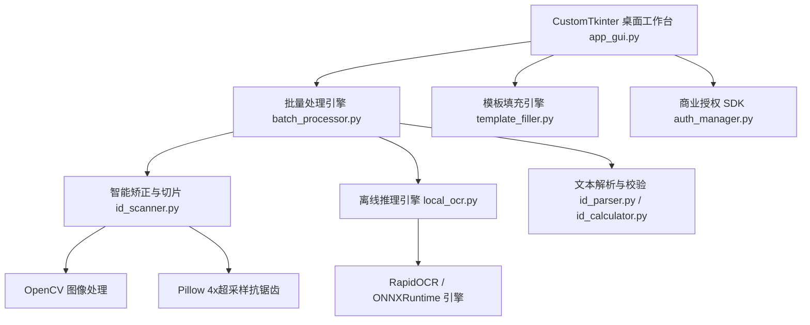

# 📐 身份证智能处理系统 · 技术架构与核心算法文档

本文档详细阐述系统的软件架构、数据流向、核心图像处理算法、离线推理机制及商业授权体系，为二次开发、系统维护及长期升级提供权威技术指引。

---

## 1. 总体系统架构

系统整体采用 **分层解耦架构**，自下而上划分为：**推理底层**、**计算机视觉核心**、**业务逻辑层** 及 **表现层 (UI)**。

---

## 2. 图像矫正与切片核心算法 (`id_scanner.py`)

### 2.1 两阶段微倾斜纠偏 (Affine Deskew)
1. **行向量角度拟合**：从本地 OCR 返回的文字包围盒中，提取各文本行左上角点 $P_0(x_0, y_0)$ 与右上角点 $P_1(x_1, y_1)$ 的方向向量：
   $$\theta = \arctan2(y_1 - y_0, x_1 - x_0)$$
2. **中位数去噪仿射**：采用所有文本行倾斜角度的中位数 $\theta_{\text{median}}$ 消除微倾斜，构建以图像中心为锚点的仿射变换矩阵 $M(\theta)$：
   $$M = \begin{bmatrix} \cos\theta & \sin\theta & (1-\cos\theta)x_c - \sin\theta y_c \\ -\sin\theta & \cos\theta & \sin\theta x_c + (1-\cos\theta)y_c \end{bmatrix}$$

### 2.2 物理搜索带约束与一阶梯度寻峰 (Gradient Peak Edge Fitting)
针对拍摄现场存在桌面杂物、键盘按键、木纹桌面的强干扰，系统杜绝直接使用外接轮廓法，改用 **语义物理搜索带 + 1D 梯度剖面极大值** 算法：
1. **构造 Sobel 梯度场**：
   $$G_x = |\text{Sobel}_x(\text{GrayBlur})|, \quad G_y = |\text{Sobel}_y(\text{GrayBlur})|$$
2. **物理窗口投影寻峰**：
   根据文字包围盒的已知宽高 $(W_{\text{text}}, H_{\text{text}})$，严格限定边缘搜索区间：
   - 顶边区间：$[y_{\min} - 0.45 H_{\text{text}}, y_{\min} - 0.10 H_{\text{text}}]$
   - 底边区间：$[y_{\max} + 0.08 H_{\text{text}}, y_{\max} + 0.35 H_{\text{text}}]$
   - 在投影剖面 $P(y) = \frac{1}{W} \sum G_y(x, y)$ 中寻找导数最大峰值，精确咬合卡片边界。

### 2.3 四点透视展平 (Perspective Transform)
将检测出的卡片四个角点源坐标 $(S_1, S_2, S_3, S_4)$ 映射至二代证 300DPI 国标印刷规范目标空间：
$$\text{CARD\_WIDTH} = 1011\text{ px}, \quad \text{CARD\_HEIGHT} = 638\text{ px} \quad (\approx 85.6\text{mm} \times 54.0\text{mm})$$
利用单应性矩阵 $H$ 进行双三次插值（`INTER_CUBIC`）展平。

### 2.4 4x 超采样平滑抗锯齿圆角模型 (Super-Sampling Anti-Aliasing)
为了彻底根除传统圆角裁切产生的**黑边残留**和**锯齿毛刺**，算法设计如下：
1. **底色与 Alpha 双重适配**：以纯白透明 `(255, 255, 255, 0)` 初始化 RGBA 画布，保证在任何丢弃透明通道的软件（如 Windows 照片查看器、Word、JPG 转换器）中显示时，四角均为纯白色；
2. **4x 超采样蒙版**：在 $4 \times 1011 = 4044, 4 \times 638 = 2552$ 超高分辨率下绘制标准国标半径 $R=3.18\text{mm}$（$R_{4x} = 38 \times 4 = 152\text{px}$）的圆角矩形；
3. **Lanczos 下采样**：通过高质量 Lanczos 滤波器将超分辨率蒙版缩放回 $1011 \times 638$，生成极高保真、过渡平滑自然的 Alpha 蒙版。

---

## 3. 文本解析流水线与容错机制 (`id_parser.py` / `id_calculator.py`)

### 3.1 GB 11643-1999 校验码算法
二代身份证号第 18 位校验码采用 ISO 7064:1983.MOD 11-2 算法严格推导：
$$\sum_{i=1}^{17} (a_i \times W_i) \pmod{11}$$
加权因子权重表：
$$W = [7, 9, 10, 5, 8, 4, 2, 1, 6, 3, 7, 9, 10, 5, 8, 4, 2]$$
校验位映射表：
$$R = [1, 0, \text{'X'}, 9, 8, 7, 6, 5, 4, 3, 2]$$

### 3.2 鲁棒性解析策略
1. **性别与年龄推算**：
   - 性别不依赖 OCR 文本中的“男/女”，以身份证第 17 位奇偶严格计算（奇=男，偶=女），防止手写体或反光干扰；
   - 周岁年龄以身份证第 7~14 位出生日期结合当前系统时间动态精确计算。
2. **生僻字与多音字规范**：
   - 身份证号末尾字母强制大写转为 `'X'`；
   - 有效期限兼容“长期”标识与普通日期格式。

---

## 4. 商业授权与安全机制 (`auth_manager.py`)

### 4.1 硬件机器码指纹算法
客户端采集以下三项不可篡改的硬件底层标识：
1. **主板 UUID**（通过 `wmic csproduct get uuid` 获取）；
2. **CPU 序列号**（通过 `wmic cpu get processorid` 获取）；
3. **主系统磁盘序列号**（通过 `wmic diskdrive get serialnumber` 获取）。

将以上硬件指纹组合加盐后执行 SHA-256 哈希计算，截取 16 位大写十六进制字符串作为该设备的唯一机器码。

### 4.2 RSA-2048 非对称离线签名
1. 开发者在服务端保存 RSA-2048 私钥；
2. 客户端内嵌对应的 RSA-2048 公钥；
3. 激活文件 `license.lic` 包含经私钥签名的授权时效、机器码及校验摘要；
4. 客户端每次启动时执行纯离线公钥验签，彻底防御本地内存篡改与假激活。

---

## 5. CI/CD 与构建工程 (`.github/workflows/build-and-release.yml`)

### 5.1 PyInstaller 打包策略
- **单文件独立封装 (`--onefile`)**：内嵌 Python 解释器、ONNX 推理引擎与权重模型；
- **无黑框窗体运行 (`--windowed`)**：隐藏控制台黑框，纯原生桌面体验；
- **资源动态收集 (`--collect-all`)**：针对 `customtkinter` 与 `rapidocr_onnxruntime` 的动态依赖文件实施全量打包装配。

### 5.2 GitHub Actions 自动化编译
- **运行载体**：GitHub 托管的纯净 `windows-latest` 虚拟机；
- **触发机制**：`workflow_dispatch` 手动触发，支持灵活指定版本号与 Release 变更日志；
- **产物分发**：自动生成 `IDCard_OCR_vX.X.X_Windows_x64.zip` 便携包并上传至 GitHub Releases。
